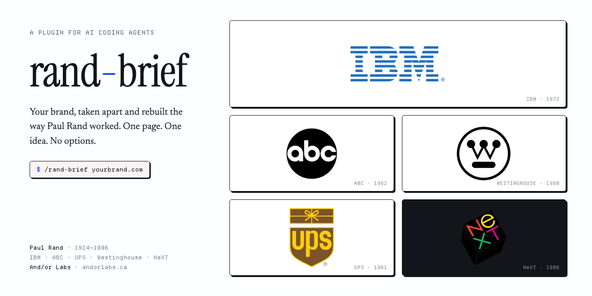

# rand-brief



**Point it at a brand. Get back a one-page design brief written the way Paul Rand worked: one idea, one recommendation, no options.**

Most brand tools generate mood boards, ten logo variations, and a paragraph of adjectives. Paul Rand — the designer behind IBM, ABC, UPS, Westinghouse, and NeXT — did the opposite. He started with the name, found the single idea hiding in it, stress-tested that idea against criteria he published, and presented **one solution** as a reasoned argument. When Steve Jobs asked him for options, he refused.

`rand-brief` encodes that method as a skill for AI coding agents.

```
/rand-brief https://yourbrand.com
```

The brief prints in your terminal and lands in your Downloads folder: `~/Downloads/rand-brief-yourbrand-2026-07-08.md`.

---

## What you get

One page (400–550 words), in the format of Rand's famous NeXT presentation booklet:

1. **The name** — what the word itself gives a designer to work with. Rand always started here.
2. **The identity today** — your current mark scored against the seven criteria Rand published in "Logos, Flags, and Escutcheons": distinctiveness, visibility, useability, memorability, universality, durability, timelessness.
3. **The idea** — the single concept for the mark: a rebus, a geometric reduction, a visual pun. Stated in one sentence, then argued.
4. **The mark** — a construction brief precise enough to draw from: geometry, the one-color test, the favicon-to-truck scale test, negative space.
5. **Typography** — a primary face and pairing from Rand's actual vocabulary, with modern licensed equivalents and free stand-ins.
6. **Color** — a flat, limited palette with hex values and a reason.
7. **In use** — favicon, lockup rules, and one application specific to your business.

It closes with a verified Rand quote — the tool refuses to use quotes that can't be sourced to his books, essays, or documented interviews.

---

## Install

### Claude Code (plugin)

```
/plugin marketplace add eclecticv/andorlabs
/plugin install rand-brief@andorlabs
```

Then `/rand-brief <url>` works in any session.

### Any agent that speaks Agent Skills

The skill lives at `skills/rand-brief/SKILL.md` in the open Agent Skills format:

```bash
npx skills add eclecticv/rand-brief --skill rand-brief
```

### Any agent at all

Clone the repo and point your agent at it. `AGENTS.md` tells it what to do:

```bash
git clone https://github.com/eclecticv/rand-brief
# then: "Read AGENTS.md in ./rand-brief and run a Rand brief on https://yourbrand.com"
```

---

## How it works

```
/rand-brief <url>
   │
   ├─ 1. PARSE      normalize URL, derive domain
   ├─ 2. EXTRACT    brand-extractor agent fetches the site →
   │                name semantics, current mark, colors, type, voice
   ├─ 3. ANALYZE    score against Rand's seven criteria,
   │                interrogate the name, choose ONE idea,
   │                stress-test it (one color / favicon scale / ten years)
   ├─ 4. COMPOSE    typeface pairing from Rand's vocabulary,
   │                flat palette, NeXT-booklet narrative voice
   └─ 5. DELIVER    full brief → your terminal,
                    rand-brief-<domain>-<date>.md → ~/Downloads/
```

The methodology is split into reference files the agent loads stage by stage, so the orchestrator stays lean and the knowledge stays inspectable:

```
skills/rand-brief/
├── SKILL.md                        the pipeline
├── references/
│   ├── rand-principles.md          his criteria, wit & the rebus, verified quotes
│   ├── typefaces.md                his faces + modern equivalents
│   ├── presentation-format.md      the NeXT-booklet method
│   └── output-schema.md            the exact brief format
└── examples/
    └── sample-brief.md             a gold-standard brief (fictional brand)
```

---

## Methodology and credits

Grounded in what Rand actually wrote and said — not design-Twitter folklore:

- *Thoughts on Design* (1947)
- *Paul Rand: A Designer's Art* (1985)
- *Design, Form, and Chaos* (1993)
- "Logos, Flags, and Escutcheons" (AIGA essay, 1991)
- The NeXT logo presentation booklet (1986) and documented accounts of the commission

Every quote in the reference files carries a source. Popular quotes that couldn't be verified are excluded by design.

## Status

v0.1.0 — early. The brief is a starting argument for a real designer, not a replacement for one. Rand would have had words about an algorithm doing this at all; the tool tries to earn its keep by being rigorous about his actual method.

## Trademarks

The IBM, ABC, UPS, Westinghouse, and NeXT logos shown above are trademarks of their respective owners. They appear here solely to identify Paul Rand's body of work. This project is not affiliated with or endorsed by any of those companies or the Paul Rand estate.

## License

MIT © And/or Labs

---

*Built by [And/or Labs](https://andorlabs.ca) — tools for people who ship.*
